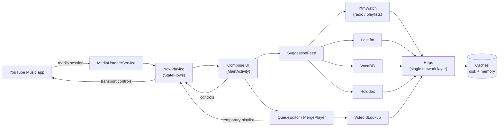

# YTM Controller

A companion app for **YouTube Music on Android**. It sits next to YTM and gives you the controls YTM doesn't: a richer Up next, smarter suggestions, adding songs or whole playlists by link, and playing merged playlists. It does all of this without replacing YTM.

**The app never plays audio itself.** All playback stays in YouTube Music, so your history, likes and Recap keep counting as normal.

> Personal project. Not affiliated with or endorsed by Google, YouTube, Samsung, Last.fm, VocaDB or Holodex.

---

## Features

### Now playing
- Shows the current song, artist, cover and progress, with play/pause, next and previous.
- **Playbar colours match the system media player.** On Samsung (One UI) phones, the background and seek-bar colours are derived from the album art the same way the notification player derives them, including One UI's fixed set of 18 seek-bar colour presets.
- **Generate radio**: starts a YTM radio from the current song without losing your place in it.

### Up next
- YTM's queue with covers. Tap a song to jump to it.
- **Add a song or a whole playlist by link** (YouTube or YT Music):
  - *Play next*, *End of Up next*, or long-press a song to insert after it.
  - Share a link from the YouTube or YT Music app straight to this app.
  - Pick from **your own playlists**, including private ones and Liked songs (needs sign-in).

### Suggestions
Two lanes, interleaved:

| Lane | Source | Why |
|---|---|---|
| Popular | **YouTube Music radio** for the song | Rich data for non-English or cover music |
| Neutral | **Last.fm** similar songs → **VocaDB** + **Holodex** → Last.fm similar artists | "People who play X also play Y", with niche sources when Last.fm has no data |

- Each row shows which source(s) suggested it. Songs suggested by several sources appear once.
- YTM's popularity bias is reduced: other versions of the current song are removed, and each
  artist is capped at 2 radio songs.
- Covers come from YTM where available, then VocaDB or Last.fm. A loading spinner and a
  ♪ "no cover" placeholder are shown differently.
- Lists are cached per song, so switching tabs doesn't refetch.

### Merge
- Combine several of your playlists (and Liked songs), shuffle them locally, and play the
  result in YTM. **Read-only:** nothing is written to your account.

### Look
- A dark YouTube Music-style theme (near-black, white, red accent).
- A red rounded-triangle launcher icon with a white "Y", including a themed (monochrome) icon.

---

## How it works

YTM has no public API for third-party control, so the app combines several pieces:

| Need | How |
|---|---|
| Read what's playing, control playback | Android `NotificationListenerService` + `MediaController` on YTM's media session |
| Find a song's YouTube video ID (YTM doesn't expose it) | YTM's web search endpoint, falling back to the official YouTube Data API |
| Read radios and playlists without playing them | YTM's web `next` endpoint |
| Play a custom queue (merges, inserted songs) | `youtube.com/watch_videos` turns up to 50 video IDs into a temporary playlist, which YTM plays |
| Your private playlists and Liked songs | Official YouTube Data API with **read-only** Google sign-in |

**Inserting into Up next** rebuilds the queue around the current song, because YTM's media
session has no "add to queue" command. The current song restarts for a moment and then jumps
back to where it was. The rebuilt queue holds at most 50 songs.

Works with the official YouTube Music app and with patched builds whose package name ends in
`.youtube.music`.

### Architecture

Every network call goes through one small layer (`Https.kt`) that enforces the security rules
below, so no feature can bypass them.

---

## Privacy and security

- **No account cookies are ever sent** to the unofficial YouTube Music endpoints. Those
  requests are anonymous, so suggestions are never personalised to your account.
- The Google sign-in is **read-only** and its token is only ever sent to `www.googleapis.com`.
- The Holodex API key is only ever sent to `holodex.net`.
- All network traffic is HTTPS, with timeouts, capped response sizes and no followed redirects.
- **Injection-resistant input handling:**
  - Every ID taken from links, shares or API responses must match a strict pattern before
    it reaches a URL or intent; everything else in the input is discarded.
  - Shared links are parsed by a pure, unit-tested parser that rejects other hosts,
    `user@host` and port tricks, non-web schemes and percent-encoded payloads.
  - Query values are URL-encoded and JSON bodies are built with a JSON library, never by
    string concatenation.
  - Shared text is only parsed, never acted on without the user confirming in a dialog.
- **Log-injection safe:** untrusted text (titles, API errors) is stripped of line breaks and
  control characters before logging, and release builds remove info/debug logging entirely.
- **Decompression-bomb safe:** image headers are checked first; absurd dimensions are
  rejected and thumbnails are decoded at a bounded size.
- Thumbnails only load from an allowlist of image hosts (YouTube, Google, Last.fm, VocaDB, NicoNico).
- **No data leaves the device:** cloud backup and device-to-device transfer are disabled,
  cleartext HTTP is disallowed, and saved lookups store hashed song keys, not titles.
- Release builds are shrunk and obfuscated with R8.

---

## Limitations

- **Unofficial endpoints** (YTM search/`next`, `watch_videos`) can change or break without notice.
- Up next songs are matched to YouTube by title, so occasionally a cover or alternate version is picked instead of the original.
- Inserting into Up Next briefly restarts the current song, and trims the queue to 50 songs.
- Last.fm has little data for many non-English, Vocaloid and VTuber songs. VocaDB only knows vocal-synth music, and Holodex only covers VTuber channels it indexes.
- The playbar colour matching follows One UI's media player specifically; other phones' players derive colours differently.

---

## Testing

JVM unit tests (`app/src/test`) cover the security-critical and logic-heavy parts:

| Suite | Covers |
|---|---|
| `LinkParserTest` | Accepted link forms, and rejection of spoofed hosts, `user@host`, ports, `javascript:`/`intent:`/`file:` schemes, percent-encoded injection, path traversal and oversized input |
| `ValidationTest` | Video/playlist ID validation, log sanitising, title normalisation, VocaDB title cleaning |
| `SuggestionMergeTest` | Lane interleaving, de-duplication across sources, cover/video precedence, per-artist caps, cover detection |

Run them with `./gradlew testDebugUnitTest`.

---

## Tech

Kotlin · Jetpack Compose (Material 3) · coroutines · `androidx.palette` · Google Play Services auth · no third-party HTTP or image libraries (plain `HttpsURLConnection` and `BitmapFactory`).

Data sources: YouTube Music (unofficial), YouTube Data API v3, [Last.fm](https://www.last.fm/api), [VocaDB](https://vocadb.net), [Holodex](https://holodex.net).
